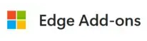

# Cookie-Editor

[](https://github.com/Moustachauve/cookie-editor/actions/workflows/npm-grunt.yml)

**Cookie-Editor** is a browser extension that makes it easy to create, edit, delete, import, and manage cookies for the current website.

It is designed for developers, testers, and privacy-conscious users who need a fast and convenient way to inspect and manage browser cookies.

## ✨ Features

Cookie-Editor provides a simple and intuitive interface for managing cookies efficiently.

Key features include:

* 🍪 Create new cookies
* ✏️ Edit existing cookies
* 🗑️ Delete individual cookies
* 🧹 Delete all cookies for the current website
* ⚡ Quickly inspect and modify cookie values
* 🧪 Useful for web development and testing
* 🔒 Helpful for manually managing cookies and privacy settings
* 📱 Touch-friendly interface for supported mobile browsers

Cookie-Editor is designed to make standard cookie operations fast and straightforward.

## 🌐 Supported Browsers

Cookie-Editor is officially supported on:

* Google Chrome
* Mozilla Firefox
* Safari
* Microsoft Edge
* Opera

It may also work on other Chromium or WebKit-based browsers, although only the browsers listed above are officially supported.

### 📱 Mobile Support

Cookie-Editor is also available on supported mobile platforms with an interface optimized for touchscreens.

Supported mobile browsers include:

* Firefox for Android
* Safari for iOS
* Microsoft Edge for Android
* Microsoft Edge for iOS

## 📦 Installation

### Google Chrome

Install Cookie-Editor from the Chrome Web Store:

[](https://chrome.google.com/webstore/detail/cookie-editor/hlkenndednhfkekhgcdicdfddnkalmdm?utm_campaign=github)

### Mozilla Firefox

Install Cookie-Editor from Firefox Add-ons:

[](https://addons.mozilla.org/addon/cookie-editor?utm_campaign=github)

### Safari

Cookie-Editor is available for both macOS and iOS and has been tested on:

* Mac
* iPhone
* iPad

Install Cookie-Editor from the Apple App Store:

[](https://apps.apple.com/app/apple-store/id6446215341?pt=126143671&ct=github&mt=8)

### Microsoft Edge

Install Cookie-Editor from the Microsoft Edge Add-ons Store:

[](https://microsoftedge.microsoft.com/addons/detail/cookieeditor/neaplmfkghagebokkhpjpoebhdledlfi?utm_campaign=github)

### Opera

Install Cookie-Editor from Opera Add-ons:

[](https://addons.opera.com/en/extensions/details/cookie-editor-2?utm_campaign=github)

## 🛠️ Development

### Prerequisites

Before building the project, make sure you have the following installed:

* [Node.js](https://nodejs.org/)
* npm

### Build Instructions

1. Clone the repository:

   ```bash
   git clone https://github.com/Moustachauve/cookie-editor.git
   ```

2. Navigate to the project directory:

   ```bash
   cd cookie-editor
   ```

3. Install the required dependencies:

   ```bash
   npm install
   ```

4. Build the project:

   ```bash
   grunt
   ```

After a successful build, the generated files will be available in the `dist` directory.

### Safari Build

Safari builds require additional steps and must be built using Xcode.

Cookie-Editor has been tested with:

* Xcode 15

## 🐛 Bug Reports and Feature Requests

Found a bug or have an idea for a new feature?

Please open an issue on GitHub:

[Create a new issue](https://github.com/Moustachauve/cookie-editor/issues)

When reporting a bug, please include as much relevant information as possible, such as:

* Browser and version
* Operating system
* Steps to reproduce the issue
* Expected behavior
* Actual behavior

## 🤝 Contributing

Contributions are welcome!

If you would like to contribute, please feel free to:

* Report bugs
* Suggest new features
* Improve documentation
* Submit pull requests

Before submitting a contribution, please ensure that your changes are properly tested.

## 🙏 Sponsors and Support

Special thanks to DigitalOcean for supporting open-source software.

<p>
  <a href="https://digitalocean.pxf.io/k0BxXd">
    
  </a>
</p>

## ⚠️ Disclaimer

This project is not an official Google project.

It is not supported by Google, and Google specifically disclaims all warranties regarding its quality, merchantability, or fitness for a particular purpose.

## 📄 License

This project is licensed under the GNU General Public License v3.0 (GPL-3.0). See the [LICENSE](LICENSE) file for more information.